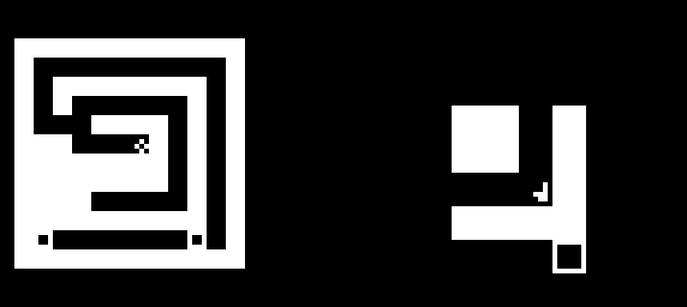

# Puzzle Maze

A memory-based maze game for the [Arduboy](https://www.arduboy.com/) handheld — written in C++ for an
ATmega32u4 with **2.5 KB of RAM** and a 128×64 monochrome display.

You see the whole maze for three seconds. After that the lights go out: only the cells within two
steps of the player stay visible, and you have 60 seconds to find the key, open the door and reach
the exit from memory.

<p align="center">
  <br>
  <sub>Left: the memorise phase, whole maze visible. Right: the same level in play, with the
  visibility radius of two cells. Rendered at the display's 128×64 resolution from the level data
  in <code>levels.cpp</code>.</sub>
</p>

## Gameplay

| | |
|---|---|
| Maze | 16 × 12 cells, 5 hand-made levels |
| Memorize phase | 3 s with the full maze visible, camera zoomed out to 0.8× |
| Play phase | visibility radius of 2 cells, camera follows the player at 1.0× |
| Time limit | 60 s per level |
| Objects | key → door → exit |
| Extras | 4 player skins, 4-page tutorial, pause, menu, victory screen |
| Frame rate | 30 FPS |

## Resource usage

Measured from the release build (`avr-gcc`, `-Os`, Arduboy2 library):

| Resource | Used | Available | |
|---|---|---|---|
| Flash (program) | 15 164 B | 28 672 B | **52.9 %** |
| RAM (`.data` + `.bss`) | 1 820 B | 2 560 B | **71.1 %** |

RAM is the binding constraint on this board, which drove most of the design decisions below.

## How it fits in memory

- **Levels live in flash, not RAM.** All five mazes are declared `PROGMEM` and copied into the single
  working buffer one cell at a time with `pgm_read_byte()`. Only one maze — `byte maze[16][12]`,
  192 B — is ever resident in RAM.
- **Player sprites are also `PROGMEM`**, read row by row at draw time, so adding skins costs flash
  instead of RAM.
- **One maze buffer, no allocation during play.** Levels are swapped in place; there is no dynamic
  allocation in the game loop.
- **Partial rendering.** Only cells inside the visibility radius are drawn, so the cost per frame
  stays roughly constant regardless of maze size.
- **Explicit state machine.** Eight states (`MENU`, `MEMORIZE`, `PLAY`, `WIN`, `GAME_OVER`,
  `TUTORIAL`, `VICTORY`, `PAUSE`) with a single transition point, which keeps the 30 FPS loop free of
  branching on flags.

## Build and flash

Requires the [Arduboy2](https://github.com/MLXXXp/Arduboy2) library.

**Arduino IDE** — open `PuzzleMaze/PuzzleMaze.ino`, select the *Arduboy* board (Arduino Leonardo),
then Upload.

**arduino-cli:**

```bash
arduino-cli lib install Arduboy2
arduino-cli compile --fqbn arduino:avr:leonardo PuzzleMaze
arduino-cli upload  --fqbn arduino:avr:leonardo -p /dev/ttyACM0 PuzzleMaze
```

## Play without the hardware

A prebuilt binary is in [`release/PuzzleMaze.hex`](release/PuzzleMaze.hex). Drop it into a browser
Arduboy emulator such as [Ardens](https://tiberiusbrown.github.io/Ardens/) or ProjectABE to play it
without a device.

## Project structure

```
PuzzleMaze/
├── PuzzleMaze.ino    # setup() / loop(), 30 FPS frame pump
├── Game.h/.cpp       # state machine, input handling, collisions, key and door logic
├── graphics.h/.cpp   # maze, player, UI, menu and tutorial rendering; camera smoothing
├── levels.h/.cpp     # five PROGMEM mazes + loader into the RAM buffer
└── config.h          # board constants, timings, camera and maze dimensions
release/PuzzleMaze.hex
```

Cell encoding: `0` floor, `1` wall, `2` door, `3` key, `4` exit.

## Known limitations

- **Sound is stubbed out.** `Game::playSound()` and the `ArduboyTones` include are commented out —
  the call sites exist, the tone generation does not.
- **No persistence.** Progress and the selected skin are not written to EEPROM, so everything resets
  on power cycle.
- Levels are hand-authored rather than generated; adding one means adding a `PROGMEM` array and a
  `case` in `loadLevel()`.
